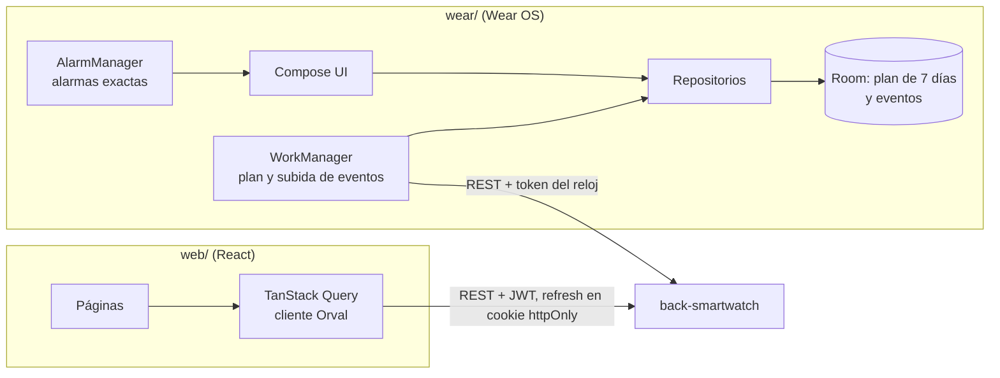

<div align="center">


# Recuerda · front-smartwatch

**Un reloj Wear OS que avisa a la hora de cada medicamento, y un panel web para que quien cuida
sepa si se tomó.**


</div>

## Contenido

1. [Qué es](#qué-es)
2. [Cómo funciona](#cómo-funciona)
3. [El reloj](#el-reloj-wear)
4. [El panel web](#el-panel-web-web)
5. [Tecnologías](#tecnologías)
6. [Diseño](#diseño)
7. [La API y el contrato](#la-api-y-el-contrato)
8. [Puesta en marcha](#puesta-en-marcha)
9. [Pruebas y CI](#pruebas-y-ci)
10. [Despliegue](#despliegue)
11. [Estructura](#estructura)

## Qué es

Recuerda es un sistema de recordatorios de medicamentos para personas que deben tomar medicación a
sus horas y para quien las cuida. Tiene dos clientes en este repositorio y **no hay app de
teléfono**:

- **`wear/`**: app **Wear OS independiente**, el producto principal. Suena a la hora de cada dosis,
  deja marcarla como tomada, posponerla u omitirla y **funciona sin internet**.
- **`web/`**: **panel web** responsive donde el paciente o su cuidador carga medicamentos y
  horarios, ve dosis por dosis si se tomaron, revisa la adherencia y los reportes, y vincula el
  reloj.

Los dos hablan con la API de [`back-smartwatch`](https://github.com/StehvenObandoUcc/back-smartwatch)
(FastAPI, en otro repositorio). Están en **español o inglés**.

## Cómo funciona



Una dosis de punta a punta:

1. En el panel web se carga un medicamento con su horario y se vincula el reloj escribiendo el
   código corto que el reloj muestra (sin teclado en el reloj).
2. El reloj descarga el plan de 7 días (`GET /devices/me/plan`, con `ETag`) cada 15 minutos y al
   abrirse, lo guarda en Room y programa una **alarma exacta** por dosis.
3. A la hora suena la alerta a pantalla completa: **Tomada**, **Posponer** (10 min, hasta 3 veces)
   u **Omitir** (con confirmación). La acción se guarda al momento en Room con un `eventId` único.
4. Con conexión, WorkManager sube los eventos en lote (`POST /devices/me/dose-events`); el backend
   es idempotente, así que reintentar es seguro.
5. En el panel, Hoy y el historial muestran cada dosis y el porcentaje de adherencia; si una dosis
   no se registra, el backend avisa por Telegram o correo.

Sin internet el reloj sigue sonando: el plan y las alarmas son locales.

## El reloj (`wear/`)

- **Alarmas exactas** con `setAlarmClock()` y el permiso `USE_EXACT_ALARM` (se concede al
  instalar). Se reprograman tras reiniciar el reloj o actualizar la app.
- **Inicio**: la próxima dosis en grande («En 1 h») y el anillo del día por el borde (un tramo por
  dosis, verde si se tomó). El fondo toma el brillo de la franja del momento: mañana, tarde o
  noche.
- **Páginas** que se deslizan: Inicio, Hoy (dosis por franja), Mes (porcentaje y últimos 7 días),
  Historial, Asistente y Reloj (vinculación, medicamentos creados en el reloj).
- **Modo sin cuenta**: se pueden crear medicamentos en el propio reloj y suenan sin internet.
- **Asistente por voz**: se pregunta hablando; responde corto en pantalla y en voz alta. Puede
  proponer un medicamento nuevo o una hora nueva para uno existente, y solo se crea al confirmar.
  No sustituye al médico.
- **Tile** «Anillo del día» y **complication** «Próxima toma» para la esfera.
- **Idioma**: español por defecto o inglés; se elige solo para la app en *Ajustes → Apps →
  Recordatorios → Idioma*.

## El panel web (`web/`)

- Landing pública, registro, inicio de sesión, verificación de correo y recuperación de
  contraseña.
- **Hoy**: anillo de dosis tomadas, la próxima con «Marcar tomada», estado del reloj (batería y
  última conexión) y franjas con Marcar tomada, Omitir y Deshacer.
- Medicamentos y horarios, agenda, historial con adherencia, reportes descargables y asistente con
  respuesta en streaming.
- Ajustes: vincular y desvincular el reloj, cuidadores e invitaciones, avisos por Telegram y
  correo, consentimientos y eliminar la cuenta.
- **Temas** claro y oscuro (o el del sistema) e **idioma** español o inglés. Se recuerda en el
  navegador y el idioma se guarda en la cuenta, para que los correos y avisos lleguen en ese idioma.

## Tecnologías

| Cliente | Para qué | Tecnología |
| --- | --- | --- |
| Reloj | Lenguaje y UI | Kotlin 2.4, Jetpack Compose for Wear OS 1.7 |
| Reloj | Datos locales | Room 2.8 (plan, eventos, medicamentos locales) |
| Reloj | Segundo plano | WorkManager 2.12, AlarmManager |
| Reloj | Red | Retrofit 3 + OkHttp 5 + kotlinx.serialization (cliente generado) |
| Reloj | Inyección | Hilt 2.60 |
| Reloj | Esfera | Tiles 1.6, Complications 1.3 |
| Reloj | Plataforma | minSdk 33 (Wear OS 4), targetSdk 37, AGP 9.4 |
| Reloj | Calidad | ktlint, detekt, JUnit, Robolectric 4.17, Truth |
| Web | Base | React 19, TypeScript 6 (strict), Vite 8 |
| Web | Estilos | Tailwind CSS 4 con tokens propios, fuente Inter Tight |
| Web | Datos | TanStack Query 5 con cliente y mocks MSW generados por Orval 8 |
| Web | Formularios | React Hook Form 7 + Zod 4 |
| Web | Rutas e idiomas | React Router 8, i18next 26 + react-i18next 17 |
| Web | Calidad | Vitest 5, Testing Library, Playwright 1.63, Storybook 10 (con axe), ESLint 9, Prettier 3 |
| CI | Integración | GitHub Actions: `.github/workflows/wear.yml` y `web.yml` |

## Diseño

- Paleta común a las dos apps: petróleo, crema, aguamarina, verde para «Tomada» y naranja para la
  alarma.
- Los colores van en **tres capas**:
  1. primitivos con nombre: `--p-*` en `web/src/design/tokens/tokens.css` y `Palette` en
     `wear/…/ui/theme/Tokens.kt`;
  2. papeles semánticos (`--bg`, `--state-taken`; `AppColors`, `BwBackgrounds`);
  3. componentes, que solo usan los papeles.
- Ningún componente lleva un color fijo: en la web lo exige ESLint. Dos pruebas vigilan las copias
  inevitables (`colors.xml` del reloj y los colores de medicamento de la web).
- Accesibilidad: WCAG 2.2 AA, texto base de 17 px en la web y 14 sp o más en el reloj, áreas
  táctiles de 48 px o más y estados con icono y texto, nunca solo color.

## La API y el contrato

- Los clientes **se generan** desde el contrato OpenAPI del backend: openapi-generator para el
  reloj (`wear/api/generated`) y Orval para la web (`web/src/api/generated*`). No se escriben a
  mano llamadas ni tipos de la API.
- `contract.lock` fija el commit del backend que se usa (hoy, el contrato **0.13.0**), y
  `scripts/sync-contract.sh` lo descarga a `.contract/openapi.yaml`.
- Para actualizar el contrato:
  1. Cambiar `contract.lock` al nuevo commit del backend.
  2. Ejecutar `bash scripts/sync-contract.sh`.
  3. Regenerar los clientes: `npx orval` en `web/` y `./gradlew :api:generateApi` en `wear/`.
- Autenticación:
  - **web**: JWT de acceso solo en memoria y refresh token en cookie `httpOnly` (Vercel reenvía
    `/auth/*` al backend para que sea de primera parte);
  - **reloj**: token del dispositivo, cifrado con el Android Keystore.
- Los errores llegan como `application/problem+json`; cada app traduce los códigos que conoce.

## Puesta en marcha

### Requisitos

- Node.js 24 y npm.
- JDK 17 o superior (sirve el de Android Studio) y Android SDK 37. El reloj necesita un
  `wear/local.properties` con `sdk.dir=...`, que no se versiona.
- [GitHub CLI](https://cli.github.com/) autenticado, para descargar el contrato.

```sh
git clone https://github.com/StehvenObandoUcc/front-smartwatch.git
cd front-smartwatch
bash scripts/sync-contract.sh
```

### Panel web

```sh
cd web
npm ci
npm run dev        # http://localhost:5173, contra la API desplegada
```

Por defecto usa la API de Heroku. Para una API local, crea `web/.env.local` con
`VITE_API_URL=http://localhost:8000`.

| Comando | Qué hace |
| --- | --- |
| `npm run dev` | Servidor de desarrollo |
| `npm run build` | Comprobación de tipos y build de producción |
| `npm run lint` · `npm run typecheck` · `npm run format:check` | ESLint, `tsc -b`, Prettier |
| `npm run test:unit` | Pruebas unitarias (Vitest + jsdom) |
| `npm test` | Unitarias más cada historia de Storybook en Chromium con axe |
| `npm run test:e2e` | E2E con Playwright sobre el build, con la API simulada |
| `npm run storybook` | Storybook en `http://localhost:6006` |

La primera vez, para las historias y las E2E: `npx playwright install chromium`.

### Reloj

```sh
cd wear
./gradlew ktlintCheck detekt testDebugUnitTest   # comprobaciones
./gradlew assembleRelease                        # APK optimizado en app/build/outputs/apk/release/
```

- **URL de la API**: la app apunta al backend desplegado (`apiBaseUrl` en
  `wear/gradle.properties`). Para el backend local en el emulador:
  `-PapiBaseUrl=http://10.0.2.2:8000/`.
- **Firma**: la release se firma con la clave de depuración, así que se instala encima de la
  versión anterior sin perder datos.

**Instalar en un reloj real por ADB inalámbrico:**

1. En el reloj, activa *Opciones de desarrollador → Depuración inalámbrica* y vincúlalo con
   `adb pair`.
2. Comprueba que aparece con `adb devices`.
3. Instala:
   ```sh
   adb push app/build/outputs/apk/release/app-release.apk /data/local/tmp/app.apk
   adb shell pm install -r /data/local/tmp/app.apk
   ```
   La instalación directa (`adb install`) a veces se queda colgada por wifi.

Comprobaciones útiles:
- `adb shell dumpsys alarm | grep recordatorios`: las alarmas programadas.
- `adb shell dumpsys package com.smartwatch.recordatorios | grep EXACT`: el permiso de alarma
  exacta.

Usa la versión **release** para probar: la de depuración pesa unos 50 MB y va mucho más lenta.

## Pruebas y CI

- **Reloj**: pruebas unitarias y de pantalla con Robolectric de alarmas, sincronización del plan,
  cola de eventos, desvinculación, asistente, formato de hora, idiomas y colores. Las pruebas de
  pantalla corren en español (`app/src/test/resources/robolectric.properties`).
- **Web**: pruebas unitarias de formularios, errores, idioma y estado de las dosis; historias de
  Storybook con axe; y E2E de humo (landing, login, panel, eliminar la cuenta y cambio a inglés).
- **CI** en cada PR:
  - `wear.yml`: ktlint, detekt, pruebas y build;
  - `web.yml`: lint, formato, tipos, pruebas, build, E2E y Storybook.

  Los cambios entran a `main` por PR con la CI en verde.

## Despliegue

- **Web**: Vercel, desde `main`. `web/vercel.json` reenvía `/auth/*` al backend, para que la cookie
  de sesión sea de primera parte. El resto de la API se llama directamente en Heroku.
- **Backend**: Heroku, desde su propio repositorio.
- **Reloj**: no se publica en Play Store; se instala como se explica arriba.

## Estructura

```
front-smartwatch/
├── wear/                               App Wear OS
│   ├── app/src/main/java/com/smartwatch/recordatorios/
│   │   ├── alarm/        Alarmas exactas, notificación de dosis, acciones y arranque
│   │   ├── complication/ Complication «Próxima toma»
│   │   ├── data/         local/ (Room) · remote/ (API, tokens, plan, eventos) · repository/
│   │   ├── di/           Módulos de Hilt
│   │   ├── sync/         WorkManager: plan y subida de eventos
│   │   ├── tile/         Tile «Anillo del día»
│   │   └── ui/           theme/ (tokens) · components/ · screens/
│   ├── app/src/main/res/ Textos (values/ en español, values-en/ en inglés), colores, fuente
│   └── api/generated/    Cliente generado desde el contrato
├── web/                                Panel web
│   ├── src/
│   │   ├── api/          Cliente y mocks MSW generados con Orval
│   │   ├── app/          Rutas, layout raíz y navegación
│   │   ├── components/   atoms/ · molecules/ · templates/
│   │   ├── design/tokens Tokens (primitivos y papeles)
│   │   ├── features/     Lógica por dominio (auth, doses, medications, patients, reports…)
│   │   ├── i18n/         Textos en es.json y en.json
│   │   ├── lib/          Cliente HTTP, fechas, errores, tema
│   │   └── pages/        Pantallas
│   ├── e2e/              Pruebas E2E con Playwright
│   └── .storybook/       Storybook
├── scripts/sync-contract.sh            Descarga el contrato fijado
├── contract.lock                       Commit del contrato del backend
└── .github/workflows/                  CI del reloj y de la web
```

No hay archivo de licencia.
